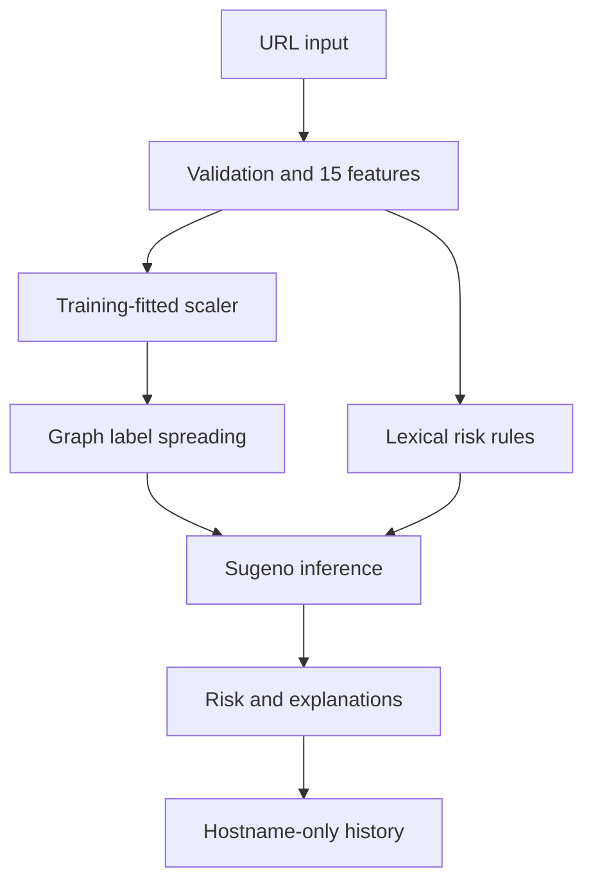

# Project guide

## Problem statement

Phishing websites imitate trusted services to steal information. URL patterns can offer useful evidence before a user opens a link. This project investigates graph-based learning on lexical URL features, followed by fuzzy inference to present a transparent risk index.

## Objectives

1. Extract repeatable features without visiting potentially malicious websites.
2. Model URL similarity as a weighted graph and learn with partially hidden labels.
3. Combine graph and lexical evidence through interpretable fuzzy rules.
4. Compare a supervised baseline, graph-only model and graph-plus-fuzzy model.
5. Provide an accessible interface for analysis, explanations and experiment results.

## Architecture

Training is an offline CLI operation. The web server only performs inference using the saved artifact. Queries do not become new training nodes, and user history never changes labels.

## Feature dictionary

| Feature | Meaning |
|---|---|
| url_length | Normalized URL characters, excluding fragment |
| host_length | ASCII/IDNA hostname characters |
| dots | Hostname dot count |
| hyphens | Hostname hyphen count |
| digit_ratio | Digit characters divided by normalized URL length |
| path_depth | Nonempty path segments |
| query_length | Query string characters |
| at_sign | Userinfo separator in authority |
| ip_host | Host parses as IPv4/IPv6 |
| http | Scheme is HTTP rather than HTTPS |
| punycode | Host contains xn-- |
| keywords | Count of distinct selected terms in decoded URL |
| percent_count | Percent signs in normalized URL |
| host_entropy | Shannon character entropy of hostname |
| nonstandard_port | Explicit port other than 80/443 |

Missing schemes default to HTTPS for parsing; this does not verify HTTPS availability. Unicode hostnames become IDNA ASCII. Features can be correlated and are not individually proof of phishing. Query text and path are analyzed but not included in inference responses/history. Training CSV and artifacts can contain sensitive host data and should be handled accordingly.

## Graph ML formulation

Each training URL is a node with a standardized feature vector z. The RBF edge weight is:

`W(i,j) = exp(-0.08 * ||z_i - z_j||²)`.

The RBF kernel creates a dense similarity graph, not hyperlinks between websites. LabelSpreading applies normalized graph smoothing with soft clamping (`alpha=0.2`). Conceptually, its iteration combines normalized neighbor label information with initial labels: `F_next = alpha*S*F + (1-alpha)*Y`. scikit-learn handles graph normalization, convergence and row-normalized final label distributions.

Thirty percent of labels in each training class are hidden (`-1`) using seed 42. Holdout data is never used in graph fitting. New queries use the fitted model's RBF-weighted inference against learned training-node distributions. The diagram in the dashboard shows only the six nearest training nodes, not all graph edges or actual site links. A node's seed label may be hidden while its propagated label distribution still contributes.

This is a legitimate graph-based ML algorithm, but not a GNN. If the project rubric specifically requires GraphSAGE, GCN or GAT, replace this learner with a graph neural network and document construction of training-only graph edges, inductive inference and leakage prevention.

## Fuzzy logic formulation

Inputs: graph phishing score g and lexical risk l, each in [0,1]. For x in that interval:

- low(x) = max(0, 1 - 2x)
- medium(x) = max(0, 1 - |2x - 1|)
- high(x) = max(0, 2x - 1)

These memberships sum to 1. Each rule's activation is the product of its two input memberships. Zero-order Sugeno consequents are:

| Graph / lexical | Low | Medium | High |
|---|---:|---:|---:|
| Low | 0.05 | 0.25 | 0.55 |
| Medium | 0.30 | 0.50 | 0.75 |
| High | 0.65 | 0.85 | 0.95 |

Output is `sum(activation * consequent) / sum(activation)`, multiplied by 100 for display. These are expert-defined prototype choices. The lexical risk sums capped weighted heuristics in `features.py`; it is not independently learned. Because lexical evidence overlaps the graph features, the inputs are correlated, and fuzzy fusion should be evaluated rather than assumed to improve results.

Scores below 35 indicate low lexical/model risk, scores from 35 to below 65 require review, and scores 65 or above indicate high risk. None of these are calibrated probabilities. The binary benchmark uses 50 as a separate, fixed threshold; three-band user decisions should also be evaluated with abstention coverage before practical use.

## Experimental protocol

The generated metrics report records dataset SHA-256, train/test counts, visible-label count, seed, thresholds, three model metrics and confusion matrices. Matrix layout is [[TN, FP], [FN, TP]], with phishing as positive class. Precision measures how often predicted phishing is correct; recall measures how much phishing is caught. ROC-AUC ranks examples independent of one cutoff. No metric alone captures deployment suitability.

The logistic baseline sees the same labeled subset as graph learning; graph learning additionally sees unlabeled training features. Scaler fitting uses training rows only. The saved detector is the evaluated model, with no post-evaluation refit on holdout. Real experiments should include an additional fully supervised baseline, alternate label budgets, multiple seeds, external datasets, domain/campaign and temporal isolation, and threshold selection on validation data.

## Suggested final report chapters

1. Abstract and problem statement.
2. Literature review with accurately cited papers actually read.
3. Requirements and system design.
4. Dataset provenance, labeling and ethics.
5. Feature extraction, graph learning and fuzzy equations.
6. Implementation, screenshots and testing.
7. Results, confusion matrices, ablations and error analysis.
8. Limitations and future work.

Do not present synthetic metrics as empirical evidence about live phishing. The included demo supports a software demonstration; a final research claim requires representative real data and appropriate validation.

## Advanced Research Extensions & Oral Defense Guide

### 1. Adversarial Evasion & Attack Perturbation
- **Mathematical premise**: Given an original URL feature vector $x \in \mathbb{R}^{15}$, attackers introduce structural perturbations $x' = x + \delta$ (such as subdomain dilution, character homoglyphs, or userinfo prefixes) attempting to cross the decision boundary into the benign region.
- **Empirical robustness metric**: Robustness is quantified by the evasion delta:
  $$\Delta_{\text{evasion}} = \mathrm{Risk}(x) - \mathrm{Risk}(x')$$
  If $\Delta > 20.0$ and the final classification drops below the review threshold (35.0), the model is flagged as susceptible to that attack vector.

### 2. Brand Impersonation & Typosquatting Metrics
- **Jaro-Winkler Similarity**: Measures character transposition sensitivity with prefix weighting:
  $$d_j = \frac{1}{3} \left( \frac{m}{|s_1|} + \frac{m}{|s_2|} + \frac{m - t}{m} \right), \quad d_w = d_j + \ell p (1 - d_j)$$
  where $m$ is matching characters, $t$ is transpositions, and $\ell \le 4$ is the common prefix length.
- **Homoglyph & Leet Normalization**: Resolves visual lookalikes (`0` to `o`, `1` to `l`, `3` to `e`, `vv` to `w`) before computing edit distances against 20+ top global target profiles.

### 3. Spectral Graph Invariants & Homophily
- **Graph Homophily Index** ($h$):
  $$h = \frac{\sum_{(i,j) \in E} A_{ij} \cdot \mathbb{I}(y_i = y_j)}{\sum_{(i,j) \in E} A_{ij}}$$
  When $h > 0.70$, high homophily validates that adjacent URLs on the RBF manifold share the same malicious/benign intent, ensuring LabelSpreading will not induce label leakage.
- **Laplacian Trace**: $\mathrm{Tr}(\tilde{L}) = \sum \lambda_i$, reflecting the total Dirichlet energy and spectral diffusion smoothness across the manifold.

### 4. Multi-Domain Campaign Clustering
- **Agglomerative Graph Partitioning**: Evaluates the affinity matrix $A_{ij} = \exp(-\gamma \|x_i - x_j\|^2)$ across batch URLs and connects component clusters at threshold $\tau = 0.55$. Groups displaying identical structural anomalies identify coordinated phishing kit campaigns.

### 5. Standardized Cyber Threat Intelligence (CTI) & SOC Automation
- **OASIS STIX 2.1**: Generates valid JSON bundles with `indicator`, `observed-data`, and `infrastructure` objects mapped to MITRE ATT&CK `T1566.002` (Spearphishing Link) and `T1583.001` (Acquire Domains).
- **Multi-Vendor Perimeter ACLs**: Produces actionable detection and containment rules for Suricata/Snort, Linux iptables, Cisco ASA, and DNS RPZ sinkholes.

---

## Viva preparation

**Why Graph ML?** It incorporates similarities among URL feature vectors and uses unlabeled training examples to shape label distributions.

**Why fuzzy logic?** It converts overlapping low/medium/high evidence into explicit graded rules. Its value must be measured against graph-only predictions.

**How are URLs connected?** Through RBF similarity in standardized feature space, not shared hyperlinks or server infrastructure.

**Does HTTPS guarantee safety?** No. Here it is only one weak textual feature.

**Can the system detect every phishing website?** No. Lexical-only features miss content, compromised hosts and many adversarial patterns.

**What should be improved next?** Representative labeled data, better split isolation, calibrated/validated thresholds, sparse graph scaling, and optional carefully isolated content/hosting feature collection.
